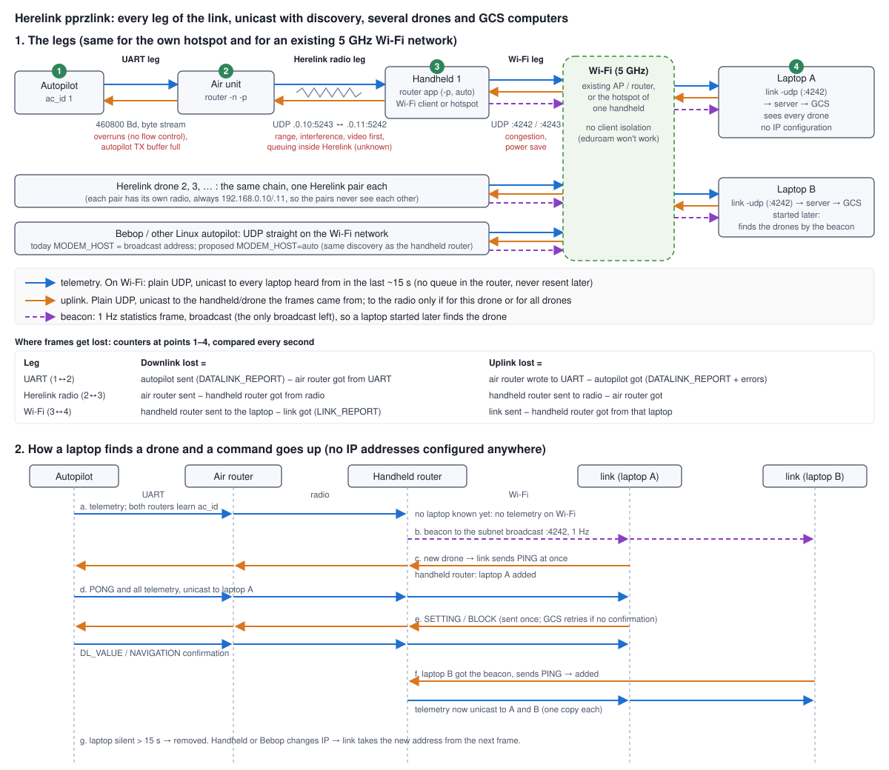

# pprzlink_router

Routes Paparazzi (pprzlink v2) frames between endpoints: UARTs and UDP sockets. It runs on any Linux
computer (a static ARM build for the Herelink), between the autopilot and the GCS computers, for example:

| Setup | Aircraft side (first endpoint) | Ground side |
|---|---|---|
| Herelink air unit | UART to the autopilot | Herelink radio (fixed UDP addresses) |
| Herelink handheld | Herelink radio | the laptops (`auto`) |
| Companion computer on a mesh radio (e.g. Doodle Labs) | UART to the autopilot | the mesh (`auto`) |
| Ground computer between a mesh and the GCS network | the aircraft on the mesh (`auto`) | the laptops (`auto`) |

A Linux autopilot (Bebop, ...) needs no router: `MODEM_HOST=auto` of `telemetry_transparent_udp` does the same
discovery (see below).



## Routing

```
pprzlink_router -e ENDPOINT -e ENDPOINT [...] [options]
  -e --endpoint uart://DEVICE:BAUD | udp://BIND_ADDR:BIND_PORT:SEND_ADDR:SEND_PORT
                       udp://BIND_ADDR:BIND_PORT:auto:PORT  (finds its peers, see below)
  -b --broadcast ADDR  also send the beacon to ADDR (e.g. when the broadcast address is not the subnet's)
  -n --no-keep-awake   do not keep the CPU awake
  -p --pprz            only forward complete pprzlink v2 frames, one at a time (always with auto)
  -s --stats MS        period of LINK_ROUTER_REPORT (default 1000, 0 = off)
  -N --node air|ground node in LINK_ROUTER_REPORT (default: air if the first endpoint is an UART)
  -v --verbose         also prints the header of every frame (sender, receiver, class, message id)
```

- **The first endpoint faces the aircraft.** What it receives (downlink) goes out of all other endpoints,
  what they receive (uplink) goes out of the first endpoint only.
- **Several aircraft.** The router learns the aircraft from their telemetry (sender id). Uplink for an aircraft
  it does not serve (receiver id) is dropped and counted; uplink for all aircraft (0xFF) goes to all.
- **`auto` endpoints find their peers**, nothing has to be configured. Every address that sends a valid frame
  to it is a peer for 15 s (`link` pings every 5 s, and at once for a new aircraft):
  - on the ground side the peers are GCS computers: they get all downlink, unicast (Wi-Fi acknowledges and
    retries unicast frames, not broadcast ones). The router's `LINK_ROUTER_REPORT` of every aircraft is also a
    1 Hz beacon, broadcast on `PORT` to every network interface (not loopback, not the address of another
    endpoint) and the `-b` addresses, so a GCS started later finds the aircraft;
  - as first endpoint the peers are aircraft (e.g. companion computers on a mesh): they are found by their
    beacon, and each gets only the uplink for its aircraft (and for all).
- Everything stays plain UDP: no frame is queued or resent later, a lost frame is lost.

How a laptop finds an aircraft:

1. A router (or a Linux autopilot with `MODEM_HOST=auto`) broadcasts its beacon once per second.
2. `link -udp` on the laptop sees a new aircraft and sends it a `PING` at once.
3. The router adds the laptop and sends it all telemetry, unicast. A laptop silent for 15 s is removed.
4. `link` sends the uplink to the address the aircraft's frames come from, also after it changed.

## Options

**Keep awake (on by default).** On the Herelink ground unit, when the CPU is idle the forwarding stalls for
~35 ms once per second. Several uplink messages then arrive late together. For external poses (OptiTrack)
on a fast-spinning drone this corrupted the attitude estimate.

- A thread at the lowest priority keeps one low-power core (CPU 0) busy, which removes the stalls.
- Measured at the air unit: 6.7–9.5 holds/min without it, 0 with it.
- Letting the thread sleep part of the time does not help.
- Use `-n` where it is not needed. The air unit's UART polling already keeps its CPU awake.

**Frame mode (`-p`).** Every endpoint parses its input as pprzlink v2 frames (STX 0x99, LEN, payload,
CK_A, CK_B). Only complete frames with a valid checksum are forwarded, one per send. This means:

- partial UART reads are never sent as fragments;
- frames from different endpoints (for example several drones) are never mixed;
- corrupted bytes are dropped at the router.

**Statistics.** Every second (`-s`) the router sends a `LINK_ROUTER_REPORT` per aircraft towards the ground,
with the aircraft id as sender. It counts per
direction the frames received, rejected (bad checksum or length), sent (one per destination) and not sent
(socket full or error), and the longest time without a frame. Compared with `DATALINK_REPORT` (autopilot) and
`LINK_REPORT` (link) this tells on which leg frames get lost: run `link_stats.py` on the laptop (add
`DATALINK_REPORT` to the telemetry of the airframe for the UART leg):

```
A/C 7, uplink to 192.168.1.23:4243, ping 31 ms, laptops found by the handheld: 2, handheld Wi-Fi -55 dBm
                   sent/s   got/s   lost  reject   unsent  max gap
down UART            97.3    97.2   0.1%       0        0    16 ms
down radio           98.2    87.1  11.3%       0        0    32 ms
down Wi-Fi           88.1    88.2   0.0%       0        0        -
up   Wi-Fi            9.8    10.1   0.0%       0        0   106 ms
up   radio           10.1     9.2   8.8%       0        0   204 ms
up   UART             9.2     9.3   0.0%       0        0        -
```

With several laptops only this laptop's uplink is known, so the Wi-Fi uplink loss is not shown. The handheld
also drops uplink for other aircraft (not over the radio) and counts it. Frames are counted exactly with `-p`; without it
the sent counters count the forwarded pieces. The air router's report goes over the radio (~56 bytes/s),
never over the UART. RSSI and SNR can be given on stdin, one line per value: `rssi <dBm>` or `snr <dB>`.

The UDP send buffer is kept small (32 kB): on a slow link frames are dropped (and counted) instead of
being delayed.

## Build

```
make                    # pprzlink_router (host) and pprzlink_router_cc (static ARM, for the Herelink)
herelink_app/build.sh   # Android app for the ground unit (see below)
```

`herelink_app/build.sh` needs `default-jdk-headless aapt dalvik-exchange apksigner android-sdk-platform-23`.

## Mesh radios (e.g. Doodle Labs)

A mesh radio carries IP, so on the aircraft a companion computer (e.g. a Raspberry Pi) runs the router between
the autopilot's UART and the mesh:

```
pprzlink_router -n -p -e uart:///dev/ttyAMA0:460800 -e udp://0.0.0.0:4245:auto:4244
```

- **Mesh bridged to the GCS network** (same subnet): use `udp://0.0.0.0:4243:auto:4242` on the aircraft.
  The laptops find the aircraft directly, no ground computer is needed.
- **Ground computer between the mesh and the GCS network** (e.g. a Raspberry Pi on the mesh radio and the
  router/Wi-Fi of the laptops): it serves all aircraft on the mesh and all laptops:

  ```
  pprzlink_router -n -p -e udp://0.0.0.0:4244:auto:4245 -e udp://0.0.0.0:4243:auto:4242
  ```

  Use other ports on the mesh (4244/4245) than on the GCS network (4242/4243): a router listening on 4242
  would also get the beacons of other routers on the GCS network (e.g. Herelink handhelds).

Do not use both at the same time (bridged and a ground computer): the laptops would get every frame twice.

## Linux autopilot (Bebop, ...)

With `telemetry_transparent_udp` and `MODEM_HOST=auto` the autopilot finds the GCS computers like an `auto`
endpoint: unicast to every address that sent to it in the last 15 s, broadcast when there is none, and one send
per second broadcast (instead of unicast) so a laptop started later finds it. A laptop with an older `link`
also finds it.

```
<module name="telemetry" type="transparent_udp">
  <configure name="MODEM_HOST" value="auto"/>
</module>
```

Several simulations on one computer all listen on port 4243: keep `link -udp -udp_broadcast` for them.

## Herelink air unit

The air unit runs a `userdebug` build, so `adb root` / `su` work. The router lives in `/oem/bin` and is
started at boot by `/system/bin/mass_storage.sh`, which calls `/oem/bin/init.sh`. Example `init.sh`
(use the baud rate of your airframe's telemetry):

```
#!/system/bin/sh
/oem/bin/pprzlink_router_cc -n -p -e uart:///dev/ttyS2:460800 -e udp://192.168.0.10:5243:192.168.0.11:5242 &
```

Use `-p`: without it a lost radio packet also breaks the frames next to it.

Disable the UART that Herelink uses for MAVLink: `setprop persist.uart.1.disable 1`.

## Herelink ground unit

The ground unit runs a `user` build (no root). Its boot scripts cannot be changed, so the router is started
by a small app (`herelink_app/`):

- At boot it starts the router (`-p`, radio endpoint and `udp://0.0.0.0:4243:auto:4242`).
- It restarts the router if the router stops.
- It keeps the Wi-Fi out of power save, and gives the router the Wi-Fi RSSI when the handheld joined a network.
- The router output is in `adb logcat -s pprzlink_router`.

Install it with:

```
adb install -r herelink_app/pprzlink_router.apk
adb shell am broadcast -n org.paparazziuav.pprzlinkrouter/.BootReceiver -f 32   # once, after installing
```

The laptop link itself (USB tethering, the hotspot, or joining a Wi-Fi network) is set in the Herelink
settings. The hotspot and joining a network cannot be used at the same time. For a Wi-Fi network:

- use 5 GHz, with no client isolation (eduroam and most guest networks do not let devices see each other);
- switch the laptop's Wi-Fi power save off (`sudo iw dev wlan0 set power_save off`).

 Android switches
USB tethering off at every boot, so it has to be switched on again each session. These scripts do it over adb,
then check the whole link. They never start a router (the app does that):

| Script | What it does |
|---|---|
| `herelink_usb.sh` | Switches USB tethering on if needed, waits for the laptop's address, then runs the check |
| `herelink_wifi.sh` | Same for the Wi-Fi hotspot (switching it on needs the USB cable for adb) |
| `herelink_check.sh [usb\|wifi\|net]` | Only checks: laptop address, ping, router and keep-awake on the handheld, link agent, telemetry, frames received twice |
| `link_stats.py` | Live loss per leg (UART, radio, Wi-Fi) and direction, see Statistics |

They end with `HEALTHY (usb)` or with `[FAIL]` lines that say what to do. Use `--wait SECONDS` when they
start together with a Paparazzi session (default 20/15 s for the link agent and telemetry). They can be added
as tools to a Paparazzi Center control panel, for example:

```
<program name="Herelink USB" command="sw/misc/link/herelink_usb.sh"/>
```

Paparazzi side: `link -udp` (it receives on port 4242 and answers to port 4243).

## Upgrading from the first version (router started by hand)

- **Ground unit:** install the app as above, no new OEM image needed (the app has its own router). Stop
  starting `/oem/bin/pprzlink_router_cc` by hand: two routers send every frame twice. If an older app was
  installed with another signing key, `adb uninstall org.paparazziuav.pprzlinkrouter` first.
- **Air unit:** the new router and `-p` in `init.sh`: build a new OEM image (below) or, as a test,
  `adb root`, `adb remount` or `mount -o remount,rw /oem`, and push `pprzlink_router_cc` and `init.sh`.
- **Laptop:** update Paparazzi (`link`) and run `link -udp` as before. The old `link` keeps working with a router
  that has a fixed address endpoint, but not with the auto endpoint (it does not know `LINK_ROUTER_REPORT`).

## Herelink OEM images

To ship the router with the Herelink firmware, build an OEM image as described in the
[CubePilot OEM image guide](https://docs.cubepilot.org/herelink/herelink-user-guides/oem-image-setup):

- Start from the base image of the right unit (`oem_ru_base.img` for the ground unit, `oem_au_base.img`
  for the air unit).
- Add `bin/pprzlink_router_cc`. For the ground unit, also add the app in `app/`.
- Flash it with `fastboot flash oem <image>`.
